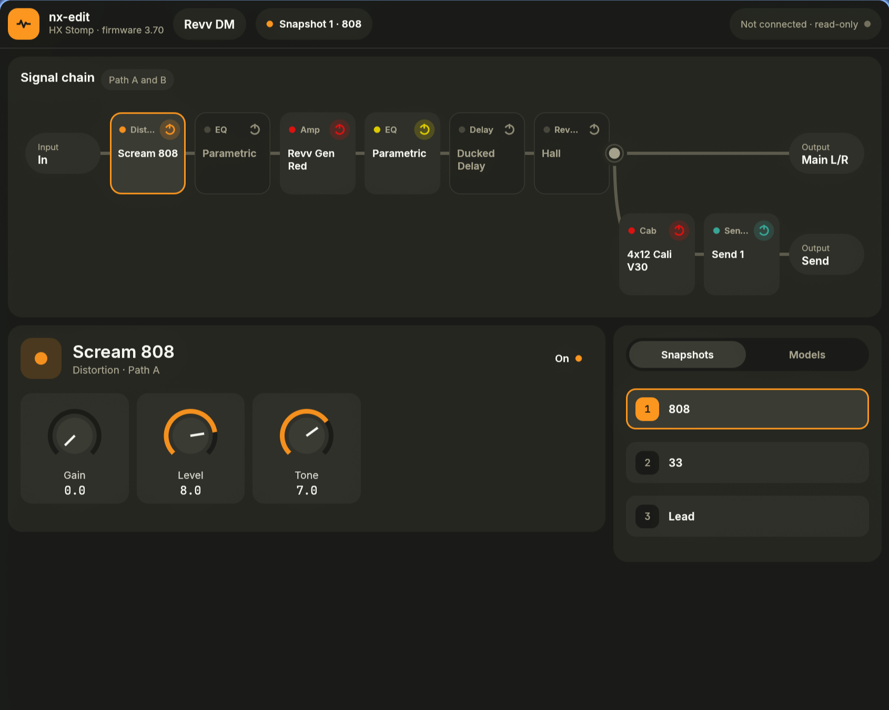

# nx-edit

A native Linux editor for the Line 6 HX Stomp, built as a replacement for HX Edit on NixOS. It
speaks the pedal's USB protocol directly. Line 6 never published that protocol; it was recovered
from USB captures of HX Edit and static analysis of its Windows binary, with tonepush's protocol
notes as a starting map (see [docs/protocol.md](docs/protocol.md)).



Tested against an HX Stomp on firmware 3.71, with HX Edit 3.82 as the reference.

## What it does

- Reads the current preset from the pedal and draws its signal chain, including path B splits and
  joins.
- Turns knobs, switches blocks on and off and changes snapshots on the pedal. It follows edits made
  on the pedal itself, and undo and redo work for knob turns.
- Lists the pedal's presets and follows preset switches.
- Keeps a library of `.hlx` files beside the pedal's list. You can drop files in, rename them and
  move them to the trash. Library presets can be edited offline and saved (Ctrl+S); nx-edit asks
  before it drops unsaved edits.
- Browses CustomTone, signs in to line6.com and downloads tones into the library.

## Not yet

- Saving a preset to the pedal, and writing to a bool or int parameter.
- Exporting the pedal's preset as an `.hlx` that HX Edit accepts.
- Importing a preset onto the pedal ("assign to the pedal").
- Firmware updates.

These wait on more captures; [docs/capture.md](docs/capture.md) lists what each one needs.

## Running

```sh
nix run ~/projects/prive/nx-edit
```

for Nix. To install it, add the flake as an input and use `packages.x86_64-linux.default`; the
package includes a desktop entry and an icon.

Block and parameter names come from HX Edit's own model data, which nx-edit does not ship. Import
it once, either from the official Windows installer, which nx-edit unpacks with 7-Zip without
running it, or from an installed HX Edit, by passing its folder (the one that holds `res`) or the
`res` folder itself:

```sh
nx-edit --import-hxedit "HX Edit v3.82 Installer.exe"
nx-edit --import-hxedit "<HX Edit folder>"
```

The data lands in `$XDG_DATA_HOME/nx-edit/hxedit-res` and the preset library in
`$XDG_DATA_HOME/nx-edit/library` (`%APPDATA%\nx-edit\hxedit-res` and `%APPDATA%\nx-edit\library` on
Windows).

```
nx-edit [preset.hlx]                      open the editor, optionally with a library preset
nx-edit --from-device                     connect to the pedal and open its current preset
nx-edit --from-capture <capture.pcapng>   show the preset found in a USB capture
nx-edit --import-hxedit <installer.exe | HX Edit folder>   import HX Edit's model data
```

Your user needs access to the pedal's USB device (vendor `0e41`, HX Stomp `0e41:4246`), for example
through a udev rule. While the pedal is passed through to a VM, nx-edit cannot reach it.

### Windows

```sh
nix build .#windows
```

cross-compiles `nx-edit.exe` with MinGW and leaves `result/nx-edit-windows-x86_64.zip`. Unzip it
anywhere; there is no installer. The Line 6 password is kept in the Windows Credential Manager.
nx-edit uses the USB driver HX Edit installed and does not install one itself; HX Edit must be
closed while nx-edit talks to the pedal.

## Development

```sh
nix develop -c cargo test --workspace
nix develop -c cargo run -p nx-app
```

The dev shell sets `LD_LIBRARY_PATH` for the libraries eframe loads at runtime. UI tests run
headless with `egui_kittest`.

The `windows` dev shell builds for `x86_64-pc-windows-gnu` and runs the tests under Wine:

```sh
WINEPREFIX=$PWD/target/wine WINEDLLOVERRIDES="mscoree=;mshtml=" nix develop .#windows -c cargo test --workspace
```

The overrides skip Wine's Mono and Gecko prompts, which otherwise stall the first run of a new
prefix.

| crate | role |
|---|---|
| `nx-app` | the egui application (`nx-edit` binary) |
| `nx-usb` | USB transport to the pedal |
| `nx-proto` | frames, messages and the preset document |
| `nx-session` | session handling: sequence numbers, acknowledgements, keep-alives |
| `nx-hlx` | reading and editing `.hlx` preset files |
| `nx-catalog` | model and parameter catalog from HX Edit's data |
| `nx-customtone` | line6.com sign-in and the CustomTone listing |
| `nx-capture` | decoding `usbmon` captures of HX Edit |

## Documentation

- [docs/protocol.md](docs/protocol.md): the USB protocol, marked as seen or inferred.
- [docs/capture.md](docs/capture.md): how captures are made, and the next session.
- [docs/reverse-engineering.md](docs/reverse-engineering.md): static analysis of HX Edit.
- [docs/customtone.md](docs/customtone.md): how CustomTone's pages and downloads work.

## License

MIT, see [LICENSE](LICENSE). This project is not affiliated with or endorsed by Line 6 or Yamaha. HX Stomp, HX Edit and
CustomTone are their trademarks.
